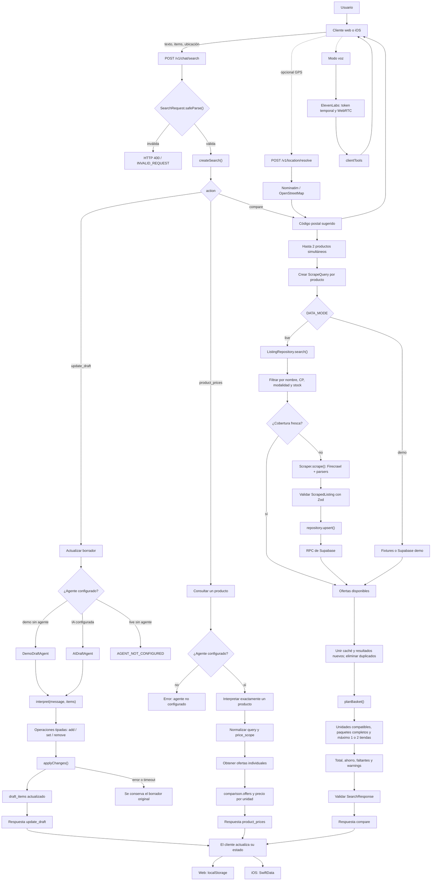
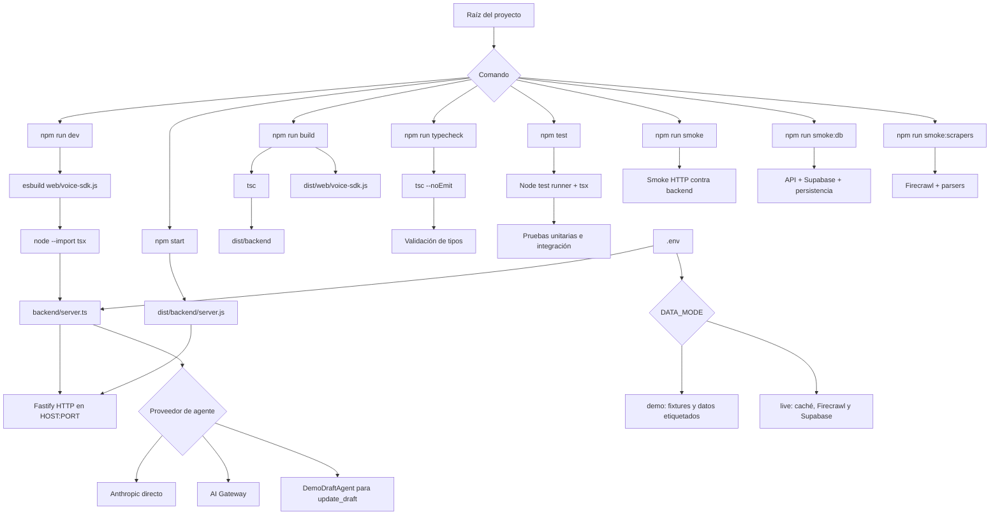

# Barasu — súper semanal, guardados y voz

Nuevo flujo de [lista semanal, conveniencia y ahorro](docs/WEEKLY_SHOPPING.md).

Estado actual y pruebas de wishlist, GPS y ElevenLabs: [guía de integración](docs/VOICE_LOCATION_WISHLIST.md). Las secciones iniciales siguientes conservan documentación histórica del MVP; para ejecutar usa [setup](docs/setup.md).

Backend local TypeScript/Node.js 22+ con Fastify, Zod y Vercel AI SDK. Implementa el acuerdo actualizado: un endpoint, borrador sin estado y comparación de una lista con hasta dos tiendas. Fuentes elegidas: **Chedraui y Bodega Aurrera**.

## Arranque local

```sh
npm ci
cp .env.example .env
npm run dev
```

http://127.0.0.1:3000 — `GET /health` muestra modo y conexiones configuradas. El modo predeterminado es **demo**: parser limitado sin modelo remoto y precios ficticios claramente etiquetados. No requiere credenciales.

```sh
curl -s http://127.0.0.1:3000/v1/chat/search \
  -H 'Content-Type: application/json' \
  -d '{"action":"update_draft","message":"Agrega 2 litros de leche, 12 huevos y 1 kg de arroz","items":[],"location":null}'

curl -s http://127.0.0.1:3000/v1/chat/search \
  -H 'Content-Type: application/json' \
  --data-binary @fixtures/compare.request.json
```

El ejemplo demo devuelve **$134.00 MXN**, con **$6.00 de ahorro ficticio** frente a $140.00 en la mejor tienda única. iOS debe enviar los `draft_items` recibidos como `items` en la comparación y conservar sus IDs. El endpoint no conserva historial ni borradores.

## Agente de lenguaje natural

Configura `AI_GATEWAY_API_KEY` y `AGENT_MODEL` (`provider/model` disponible en tu cuenta). El SDK usa AI Gateway. No se fija un proveedor ni modelo sin elegirlo con el equipo. Si ambas variables están presentes, el agente IA se usa incluso con precios demo; `DATA_MODE=live` exige agente configurado para `update_draft`.

El agente genera operaciones tipadas para agregar, reemplazar o quitar productos; el servidor valida y aplica la actualización de forma atómica. Un ID inexistente, error de modelo o timeout conserva el borrador original. No se envía historial local ni se permite al agente generar precios. Se probaron el SDK y sus salidas con modelo simulado; falta prueba con credenciales reales.

El parser demo reconoce leche, huevos, arroz y parmesano, cantidades numéricas y unidades. Ejemplos: `Agrega 2 litros de leche y 12 huevos`, `Cambia leche a 3 litros`, `Quita huevos`. Pide aclaración si no entiende. No es un sustituto del agente IA de producción.

## Firecrawl real

Configura `FIRECRAWL_API_KEY` y `DATA_MODE=live`. La clave pertenece a la aplicación; el login MCP de Codex no la configura. Los secretos van en `.env`, nunca en Git. El adaptador busca URLs de productos en los dos dominios oficiales y recupera como máximo dos fichas por tienda y producto. Los snippets de búsqueda no se usan como precios.

Los parsers específicos extraen el producto principal y precio explícito. Se conservan fechas de caché y sucursales observadas; se rechazan formatos desconocidos, bloqueos y unidades ambiguas. No se usan proxies stealth ni se resuelven CAPTCHAs. Una fuente fallida produce una respuesta parcial cuando hay otros resultados.

**Cobertura comprobada:** fichas públicas de leche y arroz de ambas tiendas mediante Firecrawl MCP, con pruebas locales sobre las respuestas capturadas. No equivale a cobertura completa ni a una prueba autenticada de la aplicación Node. Ver [evidencia y límites](docs/source-validation.md).

La ubicación aún no configura una sesión/sucursal del supermercado. Las comparaciones live con resultados incluyen `LOCATION_UNVERIFIED` y status `partial`; no se presentan como precios confirmados para el código postal solicitado.

## Comparación

- Convierte g/kg, ml/L y piece/dozen; nunca convierte peso a volumen.
- Compra paquetes completos, redondeando hacia arriba. Calcula importes en centavos.
- Evalúa combinaciones de una o dos tiendas y elige el menor costo entre los candidatos disponibles.
- Cada línea usa una sola presentación/SKU; todavía no mezcla presentaciones dentro de una misma línea ni consolida líneas duplicadas del borrador.
- Prioriza cubrir todos los productos; si no es posible, maximiza los cubiertos y luego minimiza el costo. Los faltantes quedan explícitos, no se presentan como una cesta completa.
- El ahorro usa la cesta completa más barata de una tienda, no la suma de precios regulares; es null si no hay referencia comparable o se usan datos vencidos.
- Todos los matches son `similar` hasta disponer de identidad de SKU fiable. Las notas especiales (por ejemplo, sin lactosa) se marcan para revisión; no se ignoran.
- No incluye transporte, entrega, promociones por volumen ni costos de visitar tiendas.

## Supabase y consumidores

`backend/repository.ts` define `search` y `upsert`. La integración concreta queda pendiente del esquema del responsable de datos. Se inyecta en `buildApp` en `backend/server.ts`. No se han inventado tablas ni creado otra base de datos. Sin adaptador, live consulta Firecrawl en cada comparación y no persiste.

iOS puede trabajar con `fixtures/update-draft.response.json`, `fixtures/compare.response.json`, `fixtures/compare.partial.response.json`, `fixtures/compare.empty.response.json` y `fixtures/compare.error.response.json`. Los contratos están en [contracts/api.md](contracts/api.md).

## Verificar

```sh
npm run typecheck
npm test
npm run contracts
npm run fixtures
npm run build
npm start
# En otra terminal, con el servidor en modo demo:
npm run smoke
```

Las pruebas no consumen créditos. Los scrapes live y el agente remoto sí pueden consumirlos. Timeout global: 25 segundos; máximo 20 productos y 2 productos en proceso simultáneo. El servidor escucha en loopback por defecto. No está preparado para exposición pública: faltan autenticación y límites de peticiones.

## Pendientes para integración real

1. Configurar las dos claves y elegir `AGENT_MODEL`.
2. Conectar el repositorio Supabase al esquema acordado.
3. Validar ubicación/sucursal, más categorías y restricciones de producto.
4. Revisar con el equipo los detalles de contrato todavía no definidos en el acuerdo.
5. Conectar iOS y ejecutar el caso de aceptación desde el simulador.

Todo el código permanece local; el repositorio remoto conserva únicamente el acuerdo compartido.

### Presentación local del MVP

Abre http://127.0.0.1:3000/ con `npm start`. La interfaz incluye chat,
edición de cantidades, comparación entre Chedraui y Bodega Aurrera e historial
local en el navegador. Usa la lista de ejemplo (2 L de leche, 12 huevos y 1 kg
de arroz), pulsa **Comparar precios** y muestra el resultado de $134 MXN y
$6 MXN de ahorro con los fixtures de demo. Son precios ficticios.

Para interpretar mensajes con Claude directamente, configura `ANTHROPIC_API_KEY`
y `CLAUDE_MODEL` en `.env` (solo servidor, nunca en el navegador). Sin proveedor
configurado, el modo demo utiliza el intérprete limitado de demostración.
El historial guarda comparaciones, no compras efectuadas. El modo de presentación
no consulta precios en vivo con Firecrawl.

### Integración funcional (27 octubre 2026)

- Supabase local: migraciones, seed y RPC en `database/`; adaptador en `backend/supabase-repository.ts`.
- `npm run smoke:db`: flujo completo con la base real (sin catálogo en memoria).
- `npm run smoke:scrapers`: dos consultas con la clave REST de Firecrawl.
- Se retiró el caso de queso escrito directamente en el frontend.
- Resultados web muestran fuentes, fechas, precio unitario, estado y elementos sin coincidencia.
- La app iOS del equipo usa `GroceryAPIClient`; esta rama no modifica `ios/` para evitar conflictos con el trabajo nativo de Arturo. La integración de los nuevos campos del contrato queda pendiente en su rama.
- Guía canónica actual: `docs/setup.md`; estado de entrega: `docs/integration-checklist.md`.

## Arquitectura y flujo de datos

Esta sección documenta el recorrido completo de una entrada de usuario y las
formas en que se ejecuta el código. La arquitectura actual es un monolito
modular: un único proceso Fastify sirve la web, expone la API y coordina el
agente, la caché, los scrapers y el planificador.

### Flujo completo de una entrada



### Recorrido funcional

1. El usuario escribe texto o edita productos en la web o en iOS.
2. El cliente envía el borrador actual junto con la acción solicitada.
3. Fastify valida el JSON contra SearchRequest.
4. update_draft utiliza el parser demo o el agente IA y produce operaciones
   tipadas. El backend nunca persiste el borrador.
5. product_prices interpreta un único producto y devuelve ofertas comparables,
   normalmente por precio por 100 g, 100 ml o pieza.
6. compare crea una consulta por producto, consulta la caché, actualiza las
   fuentes cuando es necesario y ejecuta el planificador de cesta.
7. La respuesta se valida contra SearchResponse antes de salir del backend.
8. El cliente guarda el resultado localmente y muestra fuentes, fechas, estado,
   tiendas y productos sin coincidencia.

### Propiedad de los datos

| Dato | Se produce en | Persistencia | Consumidor |
|---|---|---|---|
| Borrador actual | Agente y edición del cliente | localStorage o SwiftData | Web/iOS |
| Operaciones IA | DemoDraftAgent o AIDraftAgent | No se persisten | applyChanges |
| Oferta de producto | Firecrawl, fixtures o caché | Supabase y memoria de petición | Comparadores |
| Precio vigente | RPC de Supabase | prices | Backend |
| Historial de precio | RPC de Supabase | price_history | Auditoría y frescura |
| Plan de compra | planBasket o planificador web | Cliente después de comparar | Web/iOS |
| Historial personal | Cliente | localStorage o SwiftData | Historial local |
| Coordenadas GPS | Navegador | No se persisten | Nominatim |
| Código postal | Cliente | localStorage o SwiftData | Consultas posteriores |

Supabase contiene catálogo y precios, pero no el borrador ni el historial
personal. El adaptador de persistencia es la única frontera entre los registros
del scraper y las RPC de la base.

### Persistencia de catálogo

El modelo relacional está compuesto por:

    retailers
        └── stores
              └── listings
                    ├── products
                    ├── prices
                    └── price_history

Las tablas tienen RLS habilitado y el acceso se concede únicamente al
service_role del backend. Los precios se almacenan en centavos MXN. Las ofertas
también pueden contener evidencia postal e imagen de producto.

### Modos de ejecución



#### Desarrollo

npm run dev compila el SDK de voz y ejecuta TypeScript directamente mediante
tsx. Es el modo recomendado para desarrollo.

#### Ejecución compilada

npm run build ejecuta tsc y genera dist/backend, además de bundlear el SDK de
voz. npm start ejecuta dist/backend/server.js y requiere que exista un build
previo.

#### Validación

- npm run typecheck ejecuta tsc --noEmit.
- npm test ejecuta las pruebas con el runner de Node y tsx.
- npm run smoke valida el flujo HTTP demo.
- npm run smoke:db valida la integración con Supabase.
- npm run smoke:scrapers valida Firecrawl y los parsers.

#### DATA_MODE=demo

- Usa fixtures o filas aisladas con is_demo=true.
- No requiere Firecrawl ni Supabase.
- Etiqueta las ofertas como demo.
- update_draft puede utilizar DemoDraftAgent.
- La comparación completa con fixtures funciona sin credenciales externas.

#### DATA_MODE=live

- Lee ofertas desde Supabase.
- Actualiza datos con Firecrawl cuando faltan o vencen.
- Requiere FIRECRAWL_API_KEY para refrescar fuentes.
- Requiere SUPABASE_URL y SUPABASE_SERVICE_ROLE_KEY para persistencia.
- Requiere un agente IA para interpretar lenguaje natural.

#### Selección del agente

El servidor prioriza Anthropic directo si existen ANTHROPIC_API_KEY y
CLAUDE_MODEL. Si no, utiliza AI Gateway cuando existen AI_GATEWAY_API_KEY y
AGENT_MODEL. Si ninguno está configurado, update_draft usa el parser demo solo
cuando DATA_MODE=demo.

### Integración web e iOS

iOS utiliza el flujo canónico:

    update_draft → POST /v1/chat/search
    compare      → POST /v1/chat/search

El cliente iOS valida otra vez totales, subtotales, importes, IDs, fechas,
moneda y URLs antes de mostrar la comparación.

La web también utiliza /v1/chat/search, pero la experiencia de lista semanal
tiene un segundo flujo:

    product_prices por producto
            ↓
    web/weekly-plan.js
            ↓
    optimización local en el navegador

Por esta razón existen actualmente dos planificadores:

- backend/planner.ts: planificador canónico usado por compare.
- web/weekly-plan.js: optimizador de la experiencia semanal web.

Pueden producir resultados diferentes porque no comparten exactamente la misma
implementación.

### Puntos de atención actuales

1. product_prices requiere un agente configurado en el código actual. El parser
   demo se aplica automáticamente a update_draft, pero no a product_prices.
2. La web semanal no depende exclusivamente de compare; obtiene ofertas por
   producto y realiza parte de la optimización en el navegador.
3. El scraping se ejecuta de forma síncrona durante la petición HTTP. No hay
   colas ni jobs periódicos de actualización.
4. Draft e historial son locales al dispositivo. No existe sincronización entre
   dispositivos ni autenticación de usuarios.
5. El backend utiliza rutas relativas como ./web y ./fixtures; debe iniciarse
   desde la raíz del proyecto.
6. Los precios live pueden quedar en estado partial cuando la fuente falla, la
   ubicación no está confirmada o existen datos vencidos.

### Archivos principales de referencia

- API y servidor: backend/app.ts y backend/server.ts
- Orquestación: backend/service.ts
- Contratos: contracts/schema.ts y contracts/api.md
- Agente: backend/agent.ts y backend/ai-agent.ts
- Planificador backend: backend/planner.ts
- Repositorio Supabase: backend/repository.ts y backend/supabase-repository.ts
- Scrapers: scrapers/firecrawl.ts y scrapers/retailers.ts
- Base de datos: database/migrations y database/seed
- Cliente web: web/app.js y web/weekly.js
- Cliente iOS: ios/GroceryAI/Data/API/GroceryAPIClient.swift
- Configuración: .env.example, tsconfig.json, supabase/config.toml e ios/project.yml
